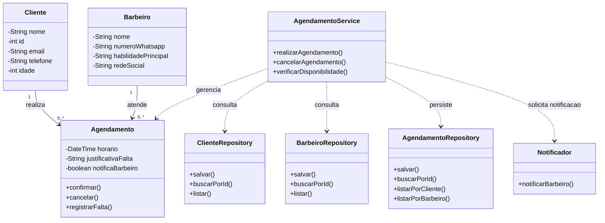

*Modelagem do Projeto* 
Aluno: João Kleber Sousa Medeiros
Domínio: A barbearia oferece serviços de corte de cabelo e barba aos clientes. Cada agendamento registra qual cliente marcou o horário, qual barbeiro foi escolhido e a data e hora do atendimento. Um agendamento só pode ser confirmado se o barbeiro estiver disponível no horário solicitado. O sistema também permite cancelar agendamentos, registrar justificativas de faltas e notificar o barbeiro sobre os horários reservados.

*ENTIDADE*: Barbeiro;  *ATRIBUTOS*: Nome, Numero_Whatsapp, Habilidade_principal, Rede_social;      *RELACIONAMENTO*: Barbeiro recebe cliente;

*ENTIDADE*: AGENDAMENTO;  *ATRIBUTOS:* Horários_disponíveis, Justificativa_falta, notifica_barbeiro;  *RELACIONAMENTO*: Agendamento notifica um barbeiro;

*ENTIDADE*: CLIENTE; *ATRIBUTOS*: NOME, ID, EMAIL, TELEFONE, IDADE; *RELACIONAMENTO*: CLiente faz vários agendamentos;

## Diagrama de Classes — Sistema de Agendamento de Barbearia



### Relacionamentos

- Um cliente pode realizar vários agendamentos.
- Um barbeiro pode estar associado a vários agendamentos.
- Cada agendamento está associado a um cliente e a um barbeiro.
- O agendamento pode notificar o barbeiro sobre o horário reservado.


## Responsabilidades
```mermaid
## 4. Responsabilidades

| Classe | Papel | Único motivo para mudar |
|---|---|---|
| `Barbeiro` | Entidade | Alterações nos dados ou nas regras próprias do barbeiro. |
| `Cliente` | Entidade | Alterações nos dados ou nas regras próprias do cliente. |
| `Agendamento` | Entidade | Alterações nas regras do agendamento, como horário, cancelamento ou registro de falta. |
```


